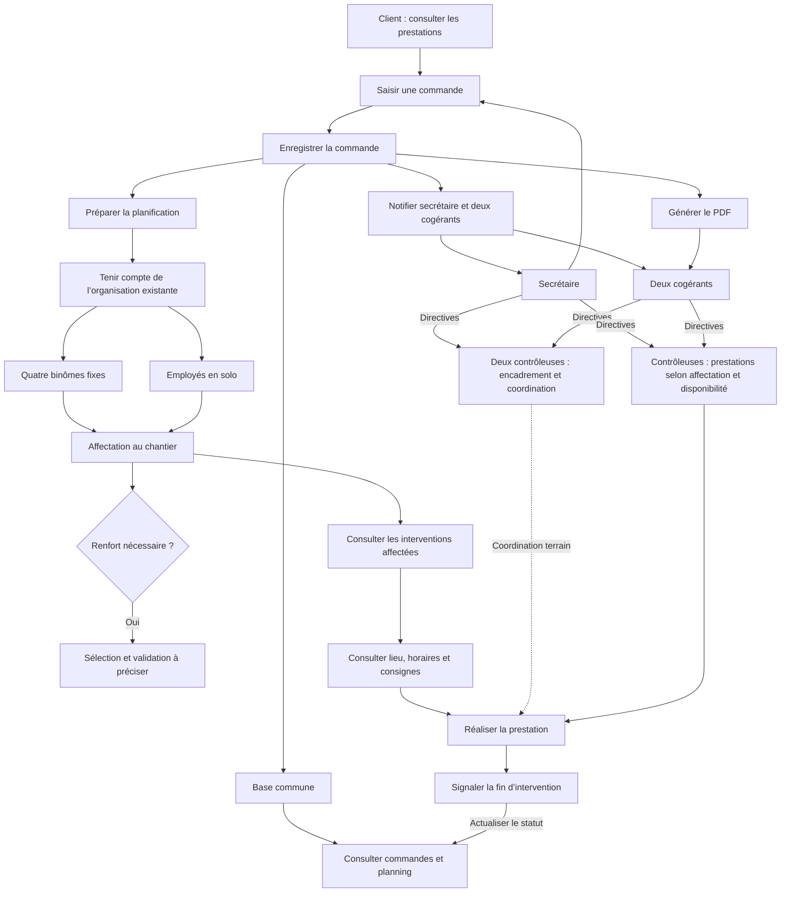

# Flux cible ÉDYSOL — intitulé contrôleuses

Version du 28 octobre 2026. Ce diagramme reprend le parcours proposé dans l’image historique `mermaid-diagram.png` avec le nouvel intitulé. C’est un support de conception, pas la preuve d’une implémentation. La disposition est propre à Mermaid ; l’image PNG historique reste inchangée.

La responsabilité de coordination ne prouve pas la disponibilité pour une prestation. Absence, binôme incomplet, sélection des renforts et approbation des réaffectations restent à définir ; aucun remplacement automatique ni passage automatique en solo n’est décidé. Les accès précis et les effets de validation d’une commande restent ceux à décider dans [le tableau de référence](DECISIONS_PREMIER_PARCOURS.md).

Ce diagramme ne complète pas silencieusement le schéma historique : les contrôles serveur, le PDF et les notifications du premier parcours devront être détaillés après les décisions indispensables. Le PDF et les notifications utiliseront les données enregistrées ; la validation technique ne vaut pas acceptation métier. Aucun message réel sans autorisation explicite.
