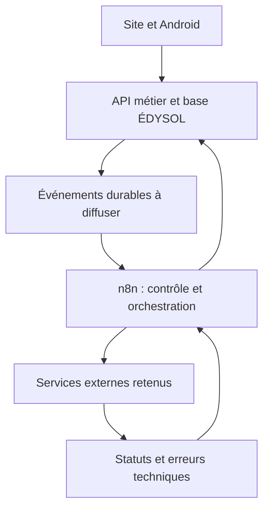

# Fonctionnement et adaptation à ÉDYSOL

Version 1.0 du 19/11/2026. Les exigences métier proviennent des décisions utilisateur visibles dans la conversation Production. L’organisation technique présentée est une proposition à examiner avec le futur backend.

## Inventaire des sources examinées

| Source au commit de référence | Examen réalisé | Portée |
| --- | --- | --- |
| `N8N/Projet_Automatisation_Commandes_WhatsApp_n8n_EvolutionAPI.pdf` | Neuf pages extraites, page 3 également rendue et examinée | Présentation d’octobre 2026, données fictives, architecture et coûts pédagogiques |
| `N8N/Comment_l_automatisation_route_vos_commandes.mp4` | Métadonnées et cinq images réparties sur 0, 15, 30, 45 et 60 secondes | Vidéo verticale 720 × 1280, 74,8 s, piste audio présente. Audio non transcrit et visionnage intégral non effectué |
| Historique Git de `N8N` | Deux commits retrouvés, `eb8b4a68c2c352f1cbeadc4e48e31fe619b1a3c1` puis `440b5cb77cfe250640dbd4ef353815d61c0f5e9d`, tous deux du 27/10/2026 | Dernier changement du dossier à 09:55:17 +11. La présentation ne désigne pas de commit source |
| `EDYSOL_Maquette/maquette_interactive/js/demo/api.js` | Lecture de l’adaptateur | Mode démonstration local. L’adaptateur serveur signale explicitement que le backend manque |
| `API/demo_pdf_edysol/` | Inventaire et README | Démonstration d’extraction PDF, distincte d’un service HTTP opérationnel |

L’arborescence suivie du dossier `N8N` ne contenait que le PDF et la vidéo. Aucun workflow à importer ni Compose à reprendre. Les fichiers d’exemple de ce guide sont nouveaux et identifiés comme laboratoire.

## Vocabulaire BTS SIO

| Terme | Explication concrète |
| --- | --- |
| Workflow | Enchaînement de traitements, par exemple recevoir un événement puis préparer une notification |
| Nœud | Bloc effectuant une étape, par exemple lire un fichier ou faire une requête HTTP |
| Déclencheur | Premier bloc, lancé par un horaire, un appel HTTP ou un événement d’un service |
| Webhook | Adresse HTTP appelée par un logiciel pour prévenir n8n d’un événement |
| Item / JSON | Objet de données transmis entre les nœuds, contenant des champs nommés |
| Credential | Connexion enregistrée dans n8n, avec ses secrets et paramètres d’authentification |
| Exécution | Passage d’un événement dans un workflow, avec état, étapes et erreurs |
| Idempotence | Un même événement réessayé produit un seul effet métier durable |
| OAuth2 | Délégation d’accès à un service, avec permissions, consentement et jetons expirables |

n8n relie des logiciels par des nœuds. Un parcours courant est déclencheur → contrôle de forme → accès à une API → décision de branchement → résultat et journal d’exécution. Les droits métier, le stockage durable et les conflits doivent rester cohérents avec le système qui fait autorité. Documentation du produit et des exécutions dans les sources S01, S05 et S06 du guide 08.

## Écart avec le PDF d’origine

Le PDF propose document entrant → extraction → catalogue de prestataires → choix de destinataire → WhatsApp → réponse. Chez ÉDYSOL, les demandes sont saisies sur le site ou par la secrétaire et destinées aux équipes de l’entreprise. Quatre binômes sont fixes, d’autres salariés travaillent seuls et deux contrôleuses participent également au ménage. Le routage automatique vers un catalogue de prestataires externes ne constitue pas une règle validée pour ÉDYSOL.

Le parcours confirmé est demande → rendez-vous d’estimation → devis → accord/refus client → programmation → réalisation/heures → fin → facturation. La décision interne direction et la réponse client ont chacune auteur, date et résultat. La place précise de la décision interne reste à déterminer. Une automatisation n’accepte pas une demande à la réception du formulaire.

JC et Mélanie, direction, fixent les prix et établissent/envoient les devis. Orélie confirme le créneau. Direction, Orélie et Yohan pendant son habilitation temporaire gèrent le planning. Les contrôleuses et Orélie proposent les renforts, Mélanie les valide. Les autorisations sont associées aux comptes et permissions configurables, jamais à une comparaison de prénoms dans un nœud. Les clés techniques n8n ne doivent pas permettre de contourner ces décisions.

## Proposition d’architecture des échanges

L’API enregistre la demande et un événement stable. n8n peut lire l’événement et appeler un endpoint technique authentifié avec cette référence. L’API vérifie les droits, versions et unicités avant effet. La base propre à n8n conserve workflows, connexions et exécutions. Elle n’est pas le modèle de données métier ÉDYSOL. Ce schéma est à construire, l’adaptateur de maquette ne fournit pas encore ce service.

Une notification de commande va individuellement à la secrétaire et aux deux cogérants. Transmission du compte rendu, problème signalé et fin d’intervention notifient aussi ce trio. Les notifications internes sont conservées par destinataire, anciennes non-lues prioritaires, lecture à l’ouverture effective autorisée, persistance entre appareils. Lire ne valide ni ne traite une action. Un accusé WhatsApp ne remplace pas cette lecture interne. Aucun canal externe confirmé n’est supprimé.

## Workflows, existence et dépendances

| Parcours | Déclencheur et étapes | Dépendances | État |
| --- | --- | --- | --- |
| Présentation historique de routage WhatsApp | Document → extraction → catalogue → prestataire → envoi et retour | Catalogue externe, canal WhatsApp, contrôle humain | Concept dans le PDF, aucun export ni déploiement fourni |
| `workflow_test_local.json` ajouté avec ce guide | POST local → contrôle de forme → trois destinataires fictifs → réponse JSON | n8n local, aucun compte externe | Laboratoire pédagogique, résultats dans 07 |
| Réception demande ÉDYSOL | Événement durable → vérification référence/version → API de notification individuelle | Backend, identités, endpoint idempotent et journal d’événements | À construire. Notification requise, choix n8n proposé |
| Devis / confirmation client | Déclenchement après action habilitée → récupération version documentaire → canal choisi → résultat d’envoi | Droits prix/devis, modèle, logiciel de facturation et canal à définir | À construire. Aucun calcul de prix ou envoi autonome accordé à n8n |
| Comptes rendus et incidents | CR transmis / problème / fin → événement stable → notifications et éventuelles tâches techniques | API métier, photos privées, règles de transmission et idempotence | À construire. Brouillon et transmission doivent rester distincts |
| Import Excel/SharePoint | Horaire ou changement de fichier → copie stable → lecture structurée → contrôle → aperçu/rejets → import autorisé | Compte Microsoft autorisé, source maître, clés, mapping et reprise | Option à arbitrer, aucun workflow fourni |
| Canal WhatsApp/Evolution API | Événement d’envoi autorisé → contrôle du destinataire → appel HTTP → suivi fournisseur | Fournisseur, licence, compte, modèles et budget retenus | Option documentée, aucune instance ou session examinée |

Pour les PDF produits depuis une demande déjà saisie, réutiliser ses données structurées pour les notifications. L’extraction du PDF est utile pour une reprise externe décidée, sans imposer de générer puis relire un document. Les réponses non fiables d’un OCR ou d’un outil d’extraction nécessitent un contrôle humain avant diffusion.
